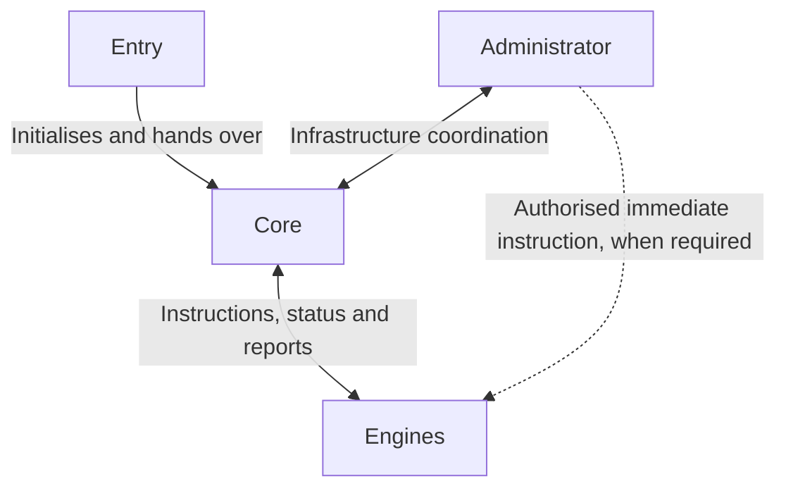

# Yatahi — Architecture

**Document version:** 0.0.1-alpha  
**Document type:** Architecture

## 1. Purpose

This document describes the architecture of Yatahi: its main components, the responsibilities each component owns, and how they work together.

Yatahi is built around four components: **Entry, Core, Engine and Administrator**. Each has a distinct role and a defined area of responsibility. The architecture separates infrastructure-wide authority from device management and service-specific work, so that no single component needs to understand or control every part of the system.

This architecture is intended to apply across different scales. Yatahi may operate on one computer running several services, in a small home laboratory, across a handful of devices, or across a large and geographically distributed infrastructure. The scale may change, but the responsibilities and boundaries described here remain the foundation.

This document explains the logical architecture and its responsibilities. It is not a specification of communication protocols, authentication mechanisms, container technology or other implementation details.

## 2. Architectural overview

The four components are:

- **Entry** — provides the initial entry point and starts the Yatahi environment.
- **Core** — manages the Yatahi environment on an individual device, including its containers and Engines.
- **Engine** — performs and maintains a specialised service or workload within its assigned container or containers.
- **Administrator** — coordinates the wider infrastructure and is responsible for infrastructure-level authority and network security.

Their responsibilities are deliberately separated:

- Administrator coordinates the infrastructure.
- Core manages the local device environment and assigns work to Engines.
- Engines understand and operate their specific services.
- Entry begins the system and hands over to Core.

The usual coordination path is between Administrator and Core, and between Core and the relevant Engines. An Administrator may also issue an immediate, authorised instruction to an Engine when required. This does not make the Engine responsible for managing the device or its containers.

The diagram represents the logical responsibilities and communication relationships. It does not prescribe where each component must run or require every deployment to have the same physical layout.

## 3. Entry

Entry is the initial entry point for Yatahi on a device. Its responsibility is to initiate the Yatahi environment and hand over operation to Core.

Entry is not the ongoing device manager, service operator or infrastructure-wide authority. Once it has completed its initial role and handed over to Core, the continuing responsibilities of managing the device and its workloads belong to the appropriate components.

## 4. Core

Core is the central management component of Yatahi on an individual device. It connects the infrastructure-level direction provided by Administrator with the specialised work performed by Engines.

Core is responsible for the device's managed Yatahi environment. It understands which managed containers and Engines exist on the device, how they are assigned, and what services they are responsible for.

### 4.1 Container management

Core is responsible for the lifecycle of Yatahi-managed containers. It can create containers when they are needed and remove containers that are managed by Yatahi when they are no longer required.

Core does not operate the services inside those containers. Creating, removing and managing the allocation of a container is different from entering it or accessing the workload that runs inside it. Core's responsibility is container management and coordination, not service operation.

### 4.2 Engine management and assignment

Core manages the Engines available on its device. This includes installing an Engine when it is needed, assigning it to the container or containers for which it is responsible, and coordinating its work.

Core does not need to understand the service-specific procedures of an Engine. It provides instructions through a common method of communication that the Engines understand. Each Engine interprets those instructions according to its own purpose and capabilities.

### 4.3 Device records and operational state

Core maintains the records needed to understand and manage its device's Yatahi environment. These include:

- Which managed containers exist.
- Which Engines are present on the device.
- Which Engine is assigned to each managed container.
- Which services each Engine is responsible for running.
- The known state and relevant operational records of those managed elements.

This gives Core an organised view of the device without requiring it to access or operate the service internals inside each container.

### 4.4 Authentication and trust

Core is responsible for important device-level authentication and trust responsibilities. This includes identifying and authenticating Administrators and determining whether incoming instructions have the appropriate authority.

Authentication and trust are central to Core's role because it is the point through which infrastructure-level direction is coordinated with the managed environment on a device. The specific mechanisms used to establish identity and authority are outside the scope of this architecture document.

### 4.5 Device-level security and reporting

Core is responsible for the security and integrity of the individual device and its managed environment. It monitors the conditions it is responsible for and identifies suspicious activity or unexpected states within that scope.

When Core detects a concern that may affect the wider infrastructure, it reports it to Administrator. Core is responsible for device-level protection; Administrator is responsible for deciding and coordinating infrastructure-wide responses.

### 4.6 Core's boundaries

Core:

- Manages the lifecycle of Yatahi-managed containers, but does not access their service internals.
- Installs and assigns Engines, but does not perform their specialised service work.
- Coordinates Engines through their shared communication method, but does not need to understand each Engine's internal service procedures.
- Manages and protects its own device environment, while reporting wider infrastructure concerns to Administrator.

## 5. Engine

An Engine is a specialised component designed to operate a particular type of service or workload. Different services can have different Engines, each with the knowledge needed to manage its own responsibility.

For example, an infrastructure may use separate Engines for web hosting, DNS, databases, backend services or other workloads. These are examples of possible specialisations, not a fixed list of required Engines.

### 5.1 Service-specific responsibility

An Engine is responsible for the service or workload it was designed to operate. Within its assigned container or containers, it performs the work needed to install, configure, run, monitor and maintain that service, in accordance with its capabilities and the instructions it receives.

Engines understand their own services. They do not require Core or Administrator to know the service-specific details of their operation.

### 5.2 Assigned container boundaries

An Engine operates within the container or containers assigned to it. Its access and responsibility are limited to its own assigned workload; it does not automatically gain access to containers assigned to other Engines.

An Engine does not create, allocate or manage the lifecycle of containers. Those responsibilities belong to Core. The Engine works within the environment that Core assigns to it.

### 5.3 Communication and instructions

Engines communicate with Core through a common method that allows Core to provide instructions and receive relevant status information and reports without understanding the internal operation of each service.

An Engine carries out Core's instructions according to its own service-specific knowledge. Where required and authorised, an Engine may also receive an immediate instruction from Administrator. Such an instruction does not remove Core's responsibility for the device's container and Engine management.

### 5.4 Workload-level security and reporting

Each Engine is responsible for the security and correct operation of its own assigned workload. It should identify suspicious conditions, service failures or unexpected activity within its area of responsibility and report relevant concerns to Core.

This keeps service-level knowledge and workload protection with the component that understands that service, while allowing Core and Administrator to respond at the device and infrastructure levels respectively.

## 6. Administrator

Administrator is the logical authority responsible for coordinating Yatahi's wider infrastructure. It operates above individual devices and their Cores, bringing participating devices and services together as one managed environment.

Administrator communicates with the Cores of participating devices, coordinates infrastructure-wide decisions and directs changes that involve more than an individual device. It does not need to know how each service is installed or configured; those responsibilities remain with the relevant Engines, coordinated through Core.

### 6.1 Infrastructure coordination

Administrator is responsible for the relationships and coordination between participating devices. It provides infrastructure-level direction, coordinates changes across devices and helps maintain a coherent view of the wider environment.

A device may participate in the infrastructure without hosting services. Other devices may run one or more specialised Engines. Administrator coordinates these different roles as parts of the same infrastructure.

### 6.2 Network-level security

Administrator is responsible for infrastructure-wide and network-level security. This includes governing how participating devices communicate across local networks and other connections, identifying suspicious devices or communication, and coordinating the isolation of a device when it is considered compromised.

The purpose is to limit the effect that a compromised device can have on the rest of the infrastructure. A problem on one device should not automatically expose every other participating device.

### 6.3 Multiple Administrators

Yatahi supports multiple Administrators with equal rights and capabilities. Infrastructure-wide authority should not depend permanently on one person or one physical device. Multiple Administrators can share responsibility for coordinating and governing the infrastructure.

### 6.4 Administrator's boundaries

Administrator is responsible for infrastructure-wide coordination and network-level security. It does not replace Core as the manager of an individual device, and it does not replace Engines as the operators of specialised services.

## 7. How the components work together

The components cooperate while retaining their separate responsibilities. The following examples illustrate their relationship at a conceptual level.

### 7.1 Starting Yatahi on a device

Entry initiates the Yatahi environment and hands over to Core. Core then takes responsibility for managing the device's Yatahi environment. The initial role of Entry is separate from Core's continuing management responsibilities.

### 7.2 Providing a service

When a service needs to be provided on a device, the work is divided according to the components' responsibilities:

1. Administrator provides or coordinates the infrastructure-level direction when the service is part of a wider infrastructure requirement.
2. Core determines the local container and Engine arrangements, creates a managed container when needed, and installs or assigns the appropriate Engine.
3. The assigned Engine performs the service-specific work inside its assigned container.
4. The Engine reports relevant state and results to Core, which maintains the device's records and coordinates further action.

This is a conceptual description of responsibility, not a requirement that every service deployment follow one identical sequence.

### 7.3 Detecting and responding to a problem

Responsibility for identifying and reporting a problem begins at the level where the problem occurs:

- An Engine identifies concerns within its assigned service or workload and reports them to Core.
- Core identifies concerns within the device and its managed environment and reports relevant infrastructure risks to Administrator.
- Administrator assesses infrastructure-wide implications and coordinates network-level responses, including isolating a compromised device when necessary.

Each component contributes to protection and recovery within its own area of responsibility. No single component needs unrestricted access to every other layer to fulfil its role.

## 8. Separation of responsibility and security

Yatahi's architecture separates responsibility across three operational levels:

| Level | Component | Primary responsibility |
|---|---|---|
| Infrastructure | Administrator | Infrastructure coordination and network-level security |
| Device | Core | Device management, container and Engine lifecycle, authentication and device-level security |
| Workload | Engine | Assigned service operation, maintenance and workload-level security |

This separation is also a security boundary. Core can manage containers without accessing the service internals inside them. An Engine is confined to the workload assigned to it rather than receiving automatic access to other Engines' containers. Administrator can coordinate and protect the wider infrastructure without taking over the specialised responsibilities of Core and Engines.

The intended result is containment: a problem in one workload should be handled at that workload's boundary where possible; a device-level concern can be addressed by Core; and a threat that affects or endangers the wider infrastructure can be handled by Administrator.

## 9. Architecture across different scales

The architecture is not reserved for large organisations or complex deployments. It is intended to accommodate a range of environments, including:

- One computer running Yatahi and hosting several services.
- A small home laboratory with two or more devices.
- Personal servers, hobby projects and small offices.
- Research environments and larger collections of devices.
- Infrastructure distributed across many locations and countries.

A small deployment should be able to use Yatahi without being treated as an incomplete version of a large enterprise environment. A large deployment should be able to grow across many devices and locations without changing the fundamental separation of responsibilities.

The architecture describes the roles needed to manage infrastructure at different scales. It does not require every deployment to use the same number of devices, services, Engines or Administrators.

## 10. Architectural boundaries and evolution

The responsibilities described in this document define the current architectural understanding of Yatahi. They establish which component owns each area of work and the boundaries that should remain clear as the implementation develops.

The document does not prescribe specific protocols, data formats, authentication algorithms, container technologies, service implementations or physical deployment layouts. Those details belong in more focused technical documentation when they are defined.

This document records the architecture at version **0.0.1-alpha**. The architecture may evolve as Yatahi develops. Future versions may refine component responsibilities, relationships and boundaries while preserving a visible history of those changes.
